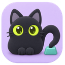

# KuroCat Tail · 黑猫打字桌宠

[](https://github.com/OhWonderL/kurocat-tail/releases/download/v1.0.3/KuroCat-Tail-1.0.3-Windows-x64.zip)

**[⬇ 下载黑猫打字桌宠安装包（ZIP）](https://github.com/OhWonderL/kurocat-tail/releases/download/v1.0.3/KuroCat-Tail-1.0.3-Windows-x64.zip)**

Windows 10 / 11（64 位）。下载后先解压，再双击里面的安装程序。



基于 [qianyiai/kurocat](https://github.com/qianyiai/kurocat) 的免费开源改版。桌面版保留经典黑猫，支持 Windows 10/11 x64。

## 改版内容

- 黑猫保留待机和双爪打字动作。尾巴从臀部后方拱成 C 形，按住 Ctrl 或 Shift，也能跟随鼠标。
- 只用鼠标时，黑猫可以腾出前爪舔爪、洗脸。
- 改版使用独立图标和应用标识。

## 安装与操作

从页面顶部下载安装包。解压后运行安装程序，通过开始菜单启动，在系统托盘退出。应用无需登录。右键桌宠可以调整缩放、键盘配列、置顶和鼠标穿透。锁定穿透后，按住 Alt 可操作桌宠。

- 打字时前爪敲键。按住 Ctrl 或 Shift 时，尾巴会按住画面里的修饰键。
- 移动鼠标或左右点击，尾巴会拨动或按下画面里的小鼠标。
- 松开键盘等 2 秒，再移动鼠标或点击，黑猫会抬爪、舔爪、擦脸。鼠标仍由尾巴在画面中操作，敲任意键可以打断洗脸。

## 本地构建

需要 Node.js、Rust 的 Windows MSVC 工具链、Visual Studio Build Tools 的 C++ 工作负载与 Windows SDK，以及 WebView2。可在 GitHub Actions 运行 `Windows x64 installer` 取得安装包。

```powershell
npm ci
npm run tauri -- build --target x86_64-pc-windows-msvc --bundles nsis
```

安装包位于 `src-tauri/target/x86_64-pc-windows-msvc/release/bundle/nsis/`。本改版的首个发布目标是 Windows x64。

## 录屏顺序

在记事本里输入一行文字，操作 Ctrl+C、Ctrl+V 和 Shift+A。松开键盘等 2 秒后，移动鼠标并交替点击左右键。等黑猫开始擦脸，再敲一个键展示它回到打字姿势。录屏可关闭按键气泡。

## 许可证

本项目采用 MIT 许可证。原版 KuroCat 由 [KuroCat Contributors](https://github.com/qianyiai/kurocat) 创作。原版权声明和许可文本见 [LICENSE](LICENSE)。
